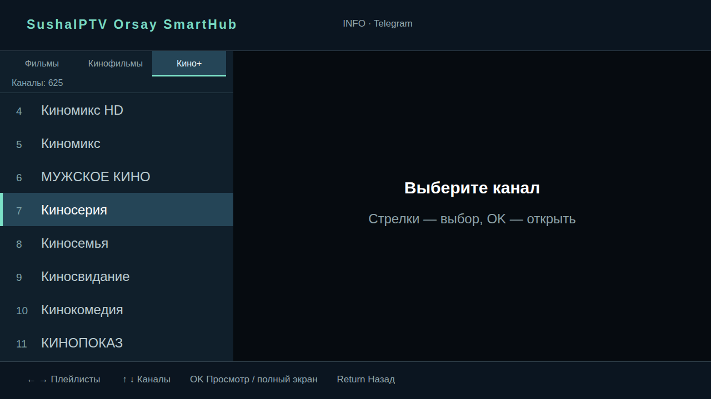

# SushaIPTV Orsay SmartHub

[Русский](README.md) | English

An IPTV app for Samsung Orsay Smart TVs. Three tabs contain snapshots of M3U playlists supplied at build time.



Browser capture.

## Install

You need an Orsay TV with Apps Sync, a computer with Python 3.9+ and three M3U files. The TV needs internet for streams after installation. Rebuild and sync to update the playlists.

- [Installation](docs/installation.md)
- [Agent instructions](docs/agent-installation.md)

## Controls

Left and right switch tabs; up and down select a channel. Press OK to play, then OK again for full screen. Return restores the list. INFO opens the Telegram QR code.

## Checks

```sh
python3 -m unittest discover -s tests -v
node tests/test-remote.js
```

Selected features of an earlier version were tested on a Samsung UA32J4303. Version 0.111 and playback without a computer still need a TV test. See [verification](TESTING.md) and [architecture](docs/architecture.md).

Playlists and ZIPs may contain private links. Keep them outside the repository. The code has no stated license yet.
